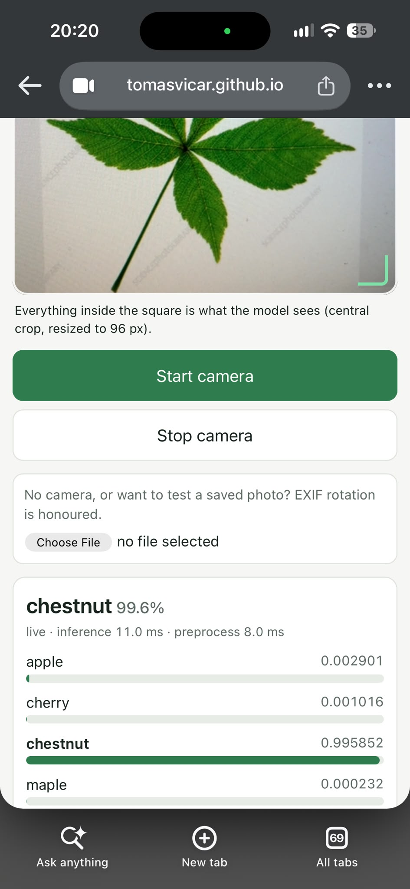
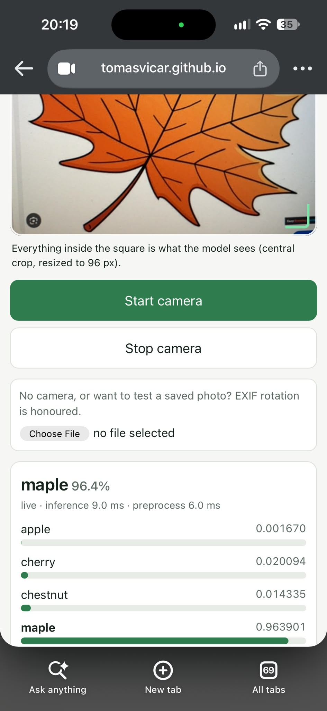
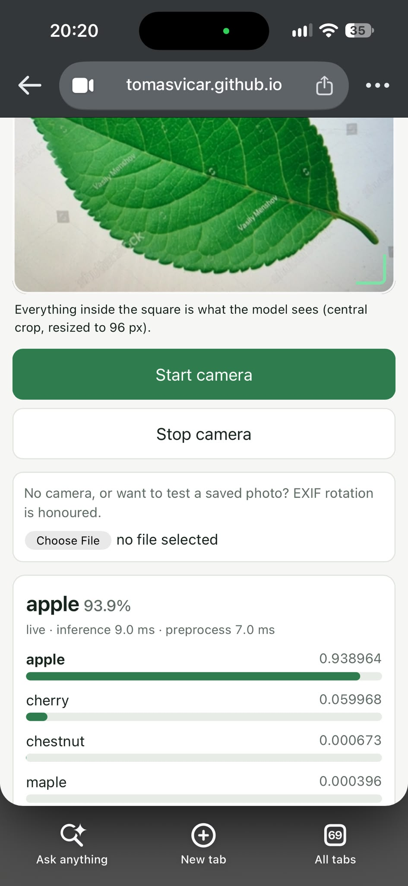
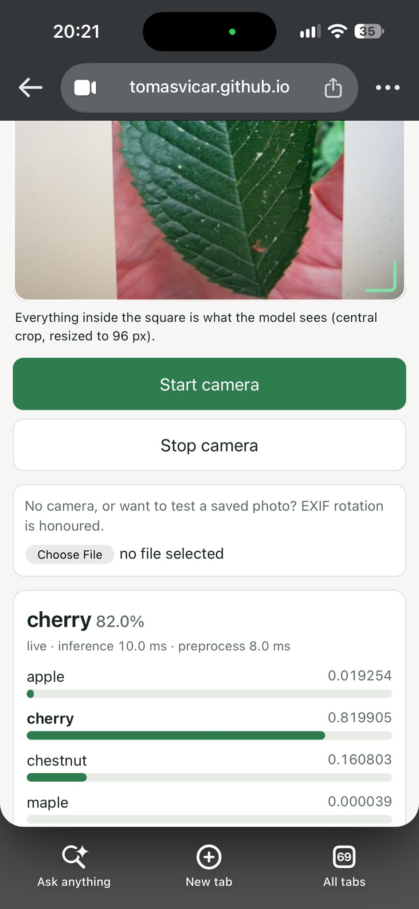

# REPORT – Task 4: a better leaf classifier
## Setup
- **Training data:** our group's photos (`data/leaves/train`), the same images for every variant.
- **Baseline:** my Task 3 `LeafNet`, trained from scratch without augmentation (Adam, lr 1e-3, batch 32, 15 epochs).
- **One change at a time** against the baseline, then a few combinations. Fixed seeds; the important rows were run with seeds 0, 1 and 2.
- **Three test sets:**
  - *normal val* – our 62 validation photos (one image = 1.6 %),
  - *camera-like val* – the same validation photos randomly cropped, rotated and colour-changed, generated once with a fixed seed, so that every variant is tested on the same images,
  - *last-year val* – last year's validation photos (30 per species, other students, other phones; one image ≈ 0.8 %). Nobody from our group photographed these leaves.
- The code is `task4.py`, written by the coding agent from my Task 3 code. The variants are marked with a `# VARIANT:` comment.

## Results

Accuracy in %, mean ± standard deviation over the seeds (one image of the 62 val images = 1.6 %).

| variant | what changed | normal val | camera-like val | last-year val | seeds |
|---|---|---|---|---|---|
| baseline | LeafNet, no augmentation (Task 3) | 66.1 ± 7.4 | 41.9 ± 12.8 | 40.0 ± 7.2 | 0,1,2 |
| augmentation | + aug_transform on the training images | 72.0 ± 2.5 | 58.1 ± 2.8 | 41.4 ± 2.4 | 0,1,2 |
| batchnorm | LeafNetBN instead of LeafNet | 72.6 | 45.2 | 37.5 | 0 |
| colorjitter | + aug_transform with ColorJitter (compare with augmentation) | 66.1 ± 4.3 | 61.3 ± 1.6 | 42.5 ± 3.0 | 0,1,2 |
| pretrained-frozen | pretrained mobilenet_v3_small, only the new last layer trained | 80.6 | 71.0 | 45.8 | 0 |
| pretrained-finetune | pretrained mobilenet_v3_small, whole network trained | 77.4 ± 2.8 | 69.4 ± 9.0 | 58.6 ± 4.6 | 0,1,2 |
| pretrained-aug-cosine | pretrained fine-tune + aug_transform + CosineAnnealingLR + 30 epochs | 82.3 ± 1.6 | 72.6 ± 3.2 | 53.3 ± 6.7 | 0,1,2 |
| dropout | dropout 0.5 after fc1 | 66.1 | 50.0 | 40.0 | 0 |
| label-smoothing | label smoothing 0.1 in the loss | 72.6 | 53.2 | 44.2 | 0 |
| best-epoch | weights of the best epoch (chosen on the normal val) | 69.4 | 58.1 | 47.5 | 0 |
| pretrained-color-cosine | pretrained fine-tune + color_aug_transform + cosine + 30 epochs | 86.0 ± 2.5 | 83.3 ± 0.9 | 61.9 ± 2.7 | 0,1,2 |
| pretrained-aug-cosine-ls | pretrained-aug-cosine + label smoothing 0.1 | 84.9 ± 0.9 | 75.8 ± 1.6 | 56.9 ± 1.0 | 0,1,2 |
| pretrained-color-cosine-ls-best | pretrained-color-cosine + label smoothing 0.1 + best epoch | 86.6 ± 4.1 | 83.9 ± 6.5 | 61.9 ± 1.0 | 0,1,2 |
| pretrained-color-cosine+lastyear | pretrained-color-cosine, trained on our train + last year's train | 83.3 ± 0.9 | 83.3 ± 1.9 | 90.0 ± 0.8 | 0,1,2 |

## What each change brought
 
**Noise first.** With nothing changed, the baseline moves by ±7.4 points on the normal val between seeds (4–5 images) and by ±12.8 points on the camera-like val. I count a difference as real only when it is clearly larger than the ± of both rows. Rows with a single seed can only be compared roughly against the baseline's spread.
- **The network trained from scratch learns the photos, not the leaves.** The baseline falls from 66 % on the normal val to about 41 % on the camera-like and last-year sets.
- **Augmentation** (geometric) raised the camera-like accuracy from 41.9 to 58.1 %. That is larger than the noise, although the baseline itself varies a lot there. On the normal val (+6) and on last year's photos (+1) the gain is within the noise.
- **ColorJitter** on top of it: 61.3 vs 58.1 % on the camera-like set, within the noise. The camera-like set itself contains colour changes, so part of this gain is expected anyway. No change on last year's photos.
- **Batch normalization**, dropout and label smoothing (one seed each) stay inside the baseline’s spread. Best epoch reached 58.1 % on the camera-like set, as high as augmentation, but with only one seed I cannot tell whether that is real.
- **The pretrained MobileNet (transfer learning)** brought the largest improvement. Fine-tuning the whole network gave 77.4 / 69.4 / 58.6 % against the baseline's 66.1 / 41.9 / 40.0 %. Training only the new last layer (one seed) was similar on our own val sets (80.6 / 71.0 %) but worse on last year's photos (45.8 vs 58.6 %).
- **Pretrained + augmentation + cosine LR + 30 epochs** was better on the normal val (82.3 vs 77.4 %), but not on the camera-like or last-year sets (within the noise). This row changes three things at once, so I cannot tell which of them helped.
- **Pretrained + colour augmentation + cosine + 30 epochs** was the best model trained on our photos only: 86.0 / 83.3 / 61.9 %. Against the same model without colour augmentation it gained 10.7 points on the camera-like set and 8.6 points on last year's photos. The last-year gain matters most, because those are real photos from other phones, but the row without colour has a large spread there (±6.7), so it is probable rather than certain.
- **Label smoothing on the pretrained model** The +3 is right: +2.6 / +3.2 / +3.6 (results.md). But on the normal val 2.6 is larger than both
  ± values (1.6 and 0.9), so it is not within noise by your own rule at line 36. Camera (3.2 vs ±3.2) is borderline.
  Only last-year (±6.7) is clearly within noise.
- **Label smoothing + best epoch on the best model** gave the same results as without them (86.6 / 83.9 / 61.9 %), with a larger spread on the camera-like set.
- **Adding last year's training photos** made no measurable difference on our normal val (83.3 vs 86.0 %) or on the camera-like val (83.3 % in both). The 90.0 % on last year's val is not a fair test, because this model was trained on photos from the same session.

## What did not work
Batch normalization, droupout, label smoothing and keeping the best epoch on the from scratch network. Label smoothing and best epoch on top of the best pretrained model

## Which model I would put on the phone
**pretrained-color-cosine**: MobileNetV3-small pretrained on ImageNet, with the whole network fine-tuned for 30 epochs using geometric and colour augmentation and a cosine learning-rate schedule. Among the models trained on our photos one of the two best on all three test sets. It also has the smallest spread on the camera-like set (±0.9), and it is simpler than the row with label smoothing and best epoch, which scores the same. It is exported as `best_leaf_model.onnx` trained with seed 0.

**Course camera app:** I loaded `best_leaf_model.onnx` into the course camera app on my iPhone 15 (on Chrome) and pointed the live camera at leaf photos from the internet shown on my PC screen, one per species. All four were classified correctly: chestnut 99.6 %, maple 96.4 % (a drawing of an orange autumn leaf), apple 93.9 % and cherry 82.0 % (with 16.1 % chestnut). Inference took about 10 ms per frame.
This is only a small check, not a measurement: four images, stock photos and one drawing. Mainly on plain light backrounds. Cherry was the least certain, and the maple was recognised even though it is orange and drawn, possibly thanks to the colour augmentation.

## Limitations
- Only 62 validation images and one to three seeds; the single-seed rows are not reliable.
- The rows that got three seeds were chosen after looking at the seed-0 results.
- The camera-like set uses the same kinds of transformations as the augmentation, which favours augmented models. Only last year's photos are a truly new photo session.
- "Frozen" was not fully frozen: the BatchNorm running statistics of the pretrained body still updated during training (`model.train()`).
- The combined rows change several things at once, so their gains cannot be split between the individual changes.