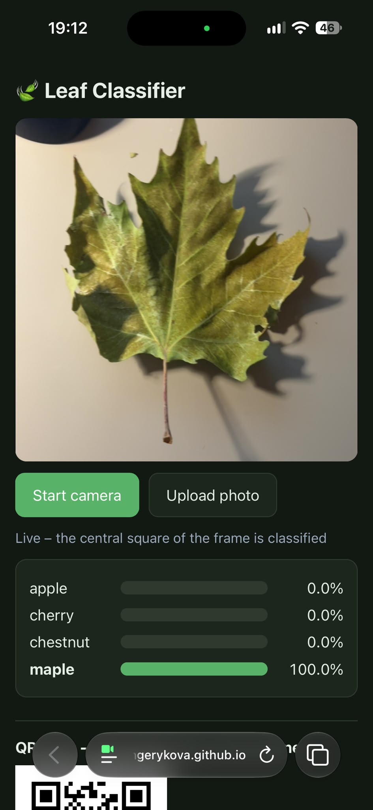
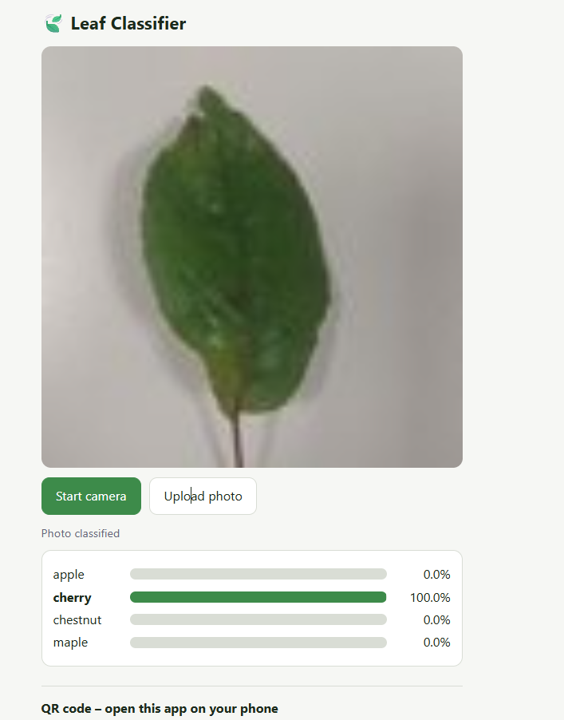
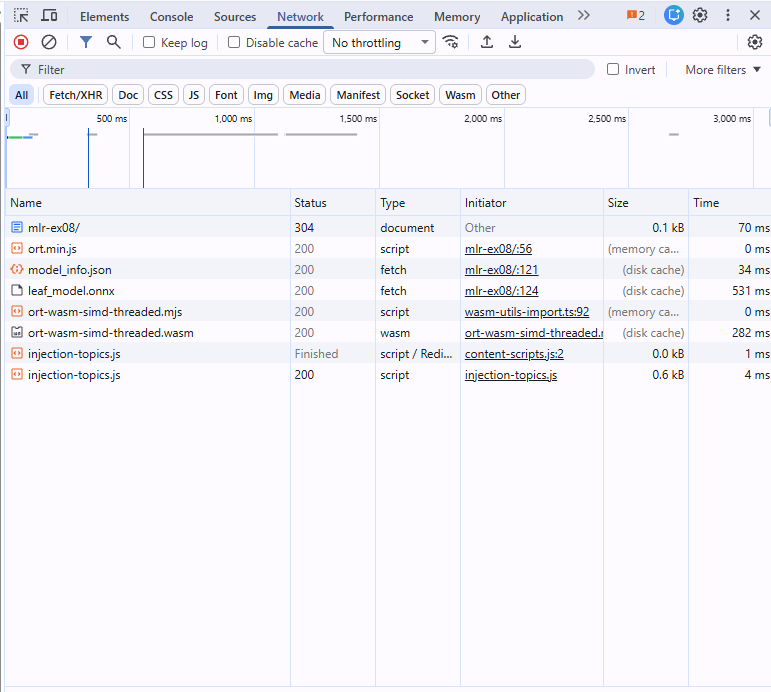

# REVIEW – Task 2: leaf classifier on the phone
**Page:** https://hgerykova.github.io/mlr-ex08/
**Tested on:** IPhone 15, Safari iOS 27.0.1 and Chrome (in REPORT)
---

## 1. It runs on my phone

**What I did:**
Scanned the QR code at the bottom of the page (and opened [https://hgerykova.github.io/mlr-ex08/](https://hgerykova.github.io/mlr-ex08/)) on an iPhone 15. Also allowed for back camera permission and the fallback upload photo button. 
**What I found:**
The page loaded over HTTPS on GitHub Pages and ran smoothly in Safari on iPhone without SharedArrayBuffer / cross-origin isolation errors (because single-threaded WebAssembly execution was forced for onnxruntime-web).The rear camera stream (facingMode: environment, playsinline) rendered inline inside the page, and the probability bars for all four classes (apple, cherry, chestnut, maple) updated live in real time.
The layout fits the IPhone screen well with the live camera view and the QR code accessible. 

In the screenshot, I tested maple leaf and it classified with 100% confidence. 
**What was fixed:**
None, works fine with Safari. 
---
## 2. The same numbers as the notebook

**What I did:**

I uploaded `check_image.jpg` with the Upload photo button on my iPhone and compared the probabilities with `check_expected.json`. I also opened [https://hgerykova.github.io/mlr-ex08/?check](https://hgerykova.github.io/mlr-ex08/?check), which classifies `check_image.jpg` and prints the largest difference from `check_expected.json`.

| class    | check_expected.json | page (upload on phone) | agree to 3 decimals? |
|----------|---------------------|------------------------|----------------------|
| apple    | 0.000018            | 0.0 % → 0.000          | yes                  |
| cherry   | 0.999981            | 100.0 % → 1.000        | yes                  |
| chestnut | 0.0000015           | 0.0 % → 0.000          | yes                  |
| maple    | 0.000000009         | 0.0 % → 0.000          | yes                  |

Max difference from the `?check` page: about 1e-7.
**What I found:**
All four probabilities agree to three decimals. The page shows one decimal of a percent, which is three decimals of a probability. A difference of about 1e-7 is only rounding, probably because the browser decodes the JPEG slightly differently from PIL and computes in float32.
This check is weak, though: cherry is almost 100 %, so even slightly wrong preprocessing could still put cherry first. An image where the probability is split between several classes, or a comparison of the raw logits, would be a stronger test.
**What was fixed:**
No fixes needed.
---

## 3. The preprocessing matches my model

| step | where in index.html                                                                                                                                   | matches model_info.json? | matches the notebook transform? |
|------|-------------------------------------------------------------------------------------------------------------------------------------------------------|--------------------------|---------------------------------|
| central square crop | lines 75, 78: `s = min(w, h)`, source rectangle `((w−s)/2, (h−s)/2, s, s)`                                                                            | model_info.json has no crop; the photos in the teacher's ZIP were centre-cropped in the same way | the transform has no crop, because the dataset images are already cropped |
| resize to 96 × 96 | line 78: `drawImage` into an n × n canvas, n = `input_size` (lines 75-76)                                                                             | yes, `input_size` = 96 | the transform has no resize, because the dataset images are already 96 × 96 |
| divide by 255 | line 81: `d[i*4+c] / 255`                                                                                                                             | yes, pixels scaled to 0–1 | yes, `ToTensor` divides by 255 |
| (x − mean) / std per channel | line 81: `info.mean[c]`, `info.std[c]`                                                                                                                | yes, the values are read from model_info.json | yes, `Normalize(mean, std)` with the same ImageNet values |
| channel order / tensor shape | lines 79–81, 87: canvas gives RGBA; R, G, B are taken and alpha skipped; index `c·96·96 + i` puts the channels first; tensor `[1, 3, 96, 96]` float32 | yes | yes, `ToTensor` gives (3, H, W) and `unsqueeze(0)` gives (1, 3, 96, 96) |

**What I found:**
The preprocessing matches. The ntb transform has no crop or resize because the leaves were already resized to 96x96.Camera frame is much larger, so the page has to do the crop and resize by itself. For `check_image.jpg`, which is already 96 × 96, the crop and resize change nothing, so the numbers match the notebook.
One small difference: the browser resizes with its own smoothing (line 77), which is not necessarily the same algorithm the teacher used for the ZIP. Live frames are therefore not resized exactly like the training images, but the effect should be small.

**What was fixed:**
Nothing needed fixing. 
---

## 4. Nothing leaves the phone

**What I did:**
I read the `fetch` calls and script tags in `index.html`, and I watched the Network tab of the browser's developer tools on my PC while the page loaded, while the camera classified and while I uploaded a test image.

| URL loaded | what it is | why it is needed |
|------------|------------|------------------|
| hgerykova.github.io/mlr-ex08/ | the page itself (`index.html`) | the app |
| cdn.jsdelivr.net/npm/onnxruntime-web@1.20.1/dist/ort.min.js | ONNX Runtime Web (line 56) | runs the network in the browser |
| cdn.jsdelivr.net/…/ort-wasm-simd-threaded.mjs and .wasm | loaded by `ort.min.js` itself, not named in `index.html` | the WebAssembly engine that computes the network |
| hgerykova.github.io/mlr-ex08/model_info.json | line 121 | class names, input size, mean and std |
| hgerykova.github.io/mlr-ex08/leaf_model.onnx | line 124 | the trained model |
| check_expected.json, check_image.jpg | only with `?check` (lines 130–131) | the self-check |
| injection-topics.js | not from the page: its initiator is `content-scripts.js` from a browser extension | – |

**Is the image sent anywhere?**
No. Camera frames (the `<video>` drawn onto an off-screen `<canvas>`) and uploaded photos are read into local pixel arrays (`ImageData`) and processed entirely on the device with JavaScript and WebAssembly. An uploaded photo only becomes a local `blob:` URL (line 118).
**What I found:**
Every request is a download (GET) made while the page loads: the page, onnxruntime-web with its WebAssembly files, the model and `model_info.json`. While the camera was classifying and after I uploaded a photo, no new requests appeared. The only `fetch` calls in the code (lines 121, 124, 130) download files, and nothing is uploaded. Two things come from outside GitHub Pages: onnxruntime-web and its WebAssembly files, from the jsdelivr CDN.
**What was fixed:**
No fixing needed. 